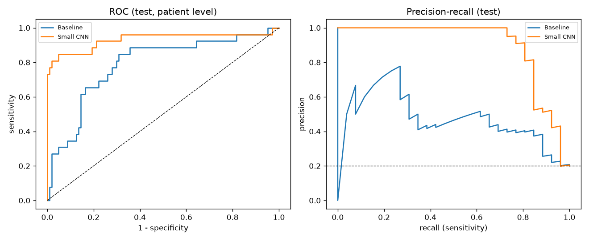

# Heart murmur detection on the CirCor DigiScope dataset

Detect if a child has a heart murmur (**Present** vs **Absent**) from
stethoscope recordings (phonocardiograms, PCG). This is a student project:
the goal is a clean, honest and reproducible pipeline, not a record score.

**Main result:** a small CNN reaches a patient-level **test AUROC of 0.932**
(95% CI 0.836-0.991), with sensitivity 0.81 and specificity 0.95. See [Results](#results).

## Project summary

- Data: 942 patient visits, 3,163 recordings at 4 kHz, from Brazil (2014 and 2015).
- Task: binary classification per patient. "Unknown" murmur labels are excluded.
- Pipeline: audit → clean patient table → split by child → filter and cut into
  5 s windows → features → models → combine windows into one prediction per patient.
- Models: a dummy model, a logistic regression on classical audio features, and
  a small CNN on log-mel spectrograms.
- No leakage: both visits of the same child are always in the same set, all
  statistics are fitted on train, and the threshold is chosen on validation.

## Dataset

**The CirCor DigiScope Phonocardiogram Dataset**, version 1.0.3, PhysioNet
(public training part): <https://physionet.org/content/circor-heart-sound/1.0.3/>

- `ID.txt`: patient information (age group, sex, height, weight, murmur label and
  description, outcome, campaign, additional ID).
- `ID_LOC.wav`: audio, 4000 Hz, at a location: AV, PV, TV, MV (or Phc).
  A repeated location is numbered, e.g. `ID_MV_1.wav`.
- `ID_LOC.hea`: WFDB header (sampling rate, number of samples).
- `ID_LOC.tsv`: segmentation: start, end, label (0 = unannotated, 1 = S1,
  2 = systole, 3 = S2, 4 = diastole).

| Murmur | Patients | Share |
|---|---|---|
| Absent | 695 | 74% |
| Present | 179 | 19% |
| Unknown (excluded) | 68 | 7% |

The data is **not** in this repository. It is released under the Open Data
Commons Attribution License (ODC-By 1.0). Please cite it (see below).

### Download

1. Download the ZIP file from the PhysioNet page above (about 470 MB), or run
   `wget -r -N -c -np https://physionet.org/files/circor-heart-sound/1.0.3/`.
2. Unzip it anywhere.
3. Open `config.yaml` and set `data_dir` to the `training_data` folder, e.g.
   `data_dir: C:/Users/you/data/circor-heart-sound-1.0.3/training_data`.

## Installation

Python 3.10 or newer. With Anaconda (Windows):

```bash
conda create -n circor python=3.11
conda activate circor
pip install -r requirements.txt
```

## How to run (in this order)

Each script runs alone, reads `config.yaml` and saves its output to
`outputs/`, `figures/` or `reports/`. Run them from the repo root.

| # | Command | What it does | Time* |
|---|---|---|---|
| 1 | `python src/data_audit.py` | File inventory, orphan files, audio audit | 5 s |
| 2 | `python src/patient_table.py` | Clean patient table, structural nan, child_id | 2 s |
| 3 | `jupyter notebook notebooks/01_eda.ipynb` | Exploration with plots | 1 min |
| 4 | `python src/segmentation.py` | Coverage of the .tsv annotations | 10 s |
| 5 | `python src/split.py` | Train / val / test split by child_id | 2 s |
| 6 | `python src/preprocess.py` | Filter, clean, cut into windows | 20 s |
| 7 | `python src/features.py` | Classical features + log-mel spectrograms | 2 min |
| 8 | `python src/train_baseline.py` | Dummy + logistic regression / random forest | 15 s |
| 9 | `python src/train_cnn.py` | Small CNN with early stopping | 10-20 min |
| 10 | `python src/evaluate.py` | Patient-level metrics, plots, error analysis | 10 s |

\* on a laptop CPU.

## Method

| Step | Choice | Why |
|---|---|---|
| Unit of analysis | Patient visit | The murmur label is given per patient, not per recording |
| Split | 70 / 15 / 15 by `child_id`, stratified | 70 children have 2 visits. Splitting by child avoids leakage |
| Resample | 4000 → 2000 Hz | Heart sounds and murmurs are below 1000 Hz. Half the data, same information |
| Band-pass | 25-400 Hz, Butterworth order 4 | Removes rumble and high-frequency noise |
| Spike removal | Clip at 3 × the median peak of 0.5 s blocks | Limits bumps and rubbing without touching normal beats |
| Normalization | Divide each recording by its own std | Uses only the recording itself, so no leakage |
| Windows | 5 s, 50% overlap | Fixed input size. 5 s ≈ 4 to 8 heart beats |
| Window filter | Drop RMS < 0.3 (silent) or > 2.0 (noise burst) | Removes about 1% of windows |
| Features (A) | 13 MFCC, spectral shape, zero-crossing rate, 3 band energies (39 values) | Simple, well-known audio features |
| Features (B) | Log-mel, 32 bands × 157 frames | Image-like input for the CNN |
| Imbalance | Class weights (`balanced`, `pos_weight`) | Present is only 20% |
| Patient prediction | Mean or max of window probabilities | Both compared on validation |
| Threshold | Best F1 on validation | Never tuned on test |

Segmentation: on average only 55% of each recording is annotated, so we do not
keep only the annotated parts. See [reports/cleaning_log.md](reports/cleaning_log.md).

## Results

Test set: 130 patients (26 Present). Patient-level results, threshold chosen on validation.

| Model | AUROC | PR-AUC | F1 | Sensitivity | Specificity |
|---|---|---|---|---|---|
| Dummy (always Absent) | 0.500 | 0.200 | 0.000 | 0.000 | 1.000 |
| Logistic regression (39 features) | 0.787 | 0.490 | 0.390 | 0.308 | 0.933 |
| **Small CNN (log-mel), mean of windows** | **0.932** | **0.899** | **0.808** | **0.808** | **0.952** |

CNN test AUROC 95% bootstrap CI: 0.836-0.991. The dummy model has 80% accuracy
but finds no murmur at all. Most missed murmurs are soft (grade I/VI).



Full tables and figures: [reports/results.md](reports/results.md).

## Limits

- **Label noise**: one label per patient is copied to every window and every
  location, but a murmur is often heard only at some locations.
- **Imbalance and small test set**: 130 test patients with 26 Present. The
  confidence intervals are wide.
- **One region, one population**: all data comes from screening campaigns in
  Paraíba, Brazil, with one type of stethoscope. Results may not transfer.
- **Two campaigns**: 15 children have different labels in 2014 and 2015
  (real change or label noise).
- **Simple noise filter**: the RMS rule finds silence and big bursts, but not
  quieter speech or crying.
- No external test set: the hidden PhysioNet test set is not public.

## Future work

- Use `Murmur locations` to label each recording (Present only where the
  murmur is heard).
- Use the S1/S2 segmentation to align windows on heart beats.
- Data augmentation (time shift, noise, SpecAugment) and a pretrained audio model.
- Second task: Outcome (Normal vs Abnormal), with the same pipeline.
- Cross-validation by child to get more stable estimates.

## Repository structure

```
circor-murmur-detection/
  config.yaml         settings (data path, sample rate, windows, seed, split)
  requirements.txt
  src/                one script per pipeline step (+ utils.py for config and paths)
  notebooks/          01_eda.ipynb
  reports/            cleaning_log.md, results.md, results_table.md
  figures/            all plots
  outputs/            generated CSV, .npy and model files (not in git)
```

## Citation

If you use this data, cite:

> Oliveira, J., Renna, F., Costa, P. D., Nogueira, M., Oliveira, C., Ferreira, C.,
> Jorge, A., Mattos, S., Hatem, T., Tavares, T., Elola, A., Rad, A. B., Sameni, R.,
> Clifford, G. D., & Coimbra, M. T. (2022). The CirCor DigiScope Dataset: From
> Murmur Detection to Murmur Classification. *IEEE Journal of Biomedical and
> Health Informatics*, 26(6), 2524-2535. https://doi.org/10.1109/JBHI.2021.3137048

> Goldberger, A., Amaral, L., Glass, L., Hausdorff, J., Ivanov, P. C., Mark, R.,
> ... & Stanley, H. E. (2000). PhysioBank, PhysioToolkit, and PhysioNet:
> Components of a new research resource for complex physiologic signals.
> *Circulation*, 101(23), e215-e220.

Dataset license: ODC Attribution License (ODC-By) v1.0.
