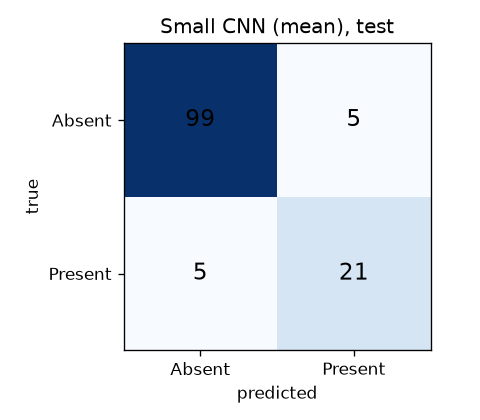
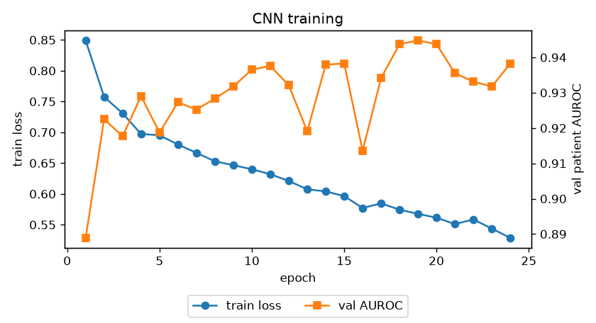

# Results

All numbers are at the **patient level** (one prediction per patient visit).
Validation: 135 patients (27 Present). Test: 130 patients (26 Present).
The threshold of each model is chosen on validation (best F1), then used on test.
The full table (mean and max aggregation, both sets) is in
[results_table.md](results_table.md).

## Main table (test set, mean aggregation)

| Model | AUROC | PR-AUC | F1 | Sensitivity | Specificity | Accuracy |
|---|---|---|---|---|---|---|
| Dummy (always Absent) | 0.500 | 0.200 | 0.000 | 0.000 | 1.000 | **0.800** |
| Baseline (logistic regression) | 0.787 | 0.490 | 0.390 | 0.308 | 0.933 | 0.808 |
| **Small CNN (log-mel)** | **0.932** | **0.899** | **0.808** | **0.808** | **0.952** | **0.923** |

- The CNN test AUROC has a 95% bootstrap confidence interval of **0.836-0.991**.
  The test set is small, so the interval is wide.
- The dummy model has 80% accuracy and finds **zero** murmurs. This shows why
  accuracy alone is not a good metric here.
- The baseline is better than chance (AUROC 0.79), but at the chosen threshold
  it finds only 8 of the 26 Present patients.

## Mean vs max aggregation (validation, used for the choice)

| Model | Mean AUROC | Max AUROC |
|---|---|---|
| Baseline | **0.806** | 0.669 |
| Small CNN | **0.945** | 0.898 |

Mean is better for both models. One noisy window can push the max up, so
max gives more false alarms. Final model = **Small CNN + mean**, chosen on
validation AUROC.

Note: the CNN validation AUROC (0.945) is a bit optimistic, because validation
was also used for early stopping. The test AUROC (0.932) is the honest number.

## Confusion matrix (Small CNN, test, threshold 0.57)

|  | Predicted Absent | Predicted Present |
|---|---|---|
| **True Absent** | 99 | 5 |
| **True Present** | 5 | 21 |

## Error analysis (test)

**Missed murmurs (5 false negatives)**

| Patient | Probability | Grade | Timing | Heard at |
|---|---|---|---|---|
| 36327 | 0.35 | I/VI | Holosystolic | MV+PV+TV |
| 49630 | 0.42 | I/VI | Holosystolic | MV+PV+TV |
| 50129 | 0.44 | II/VI | Holosystolic | AV+MV+PV+TV |
| 50159 | 0.11 | I/VI | Early-systolic | MV only |
| 50258 | 0.55 | I/VI | Early-systolic | TV only |

- **Soft murmurs are the problem.** 4 of the 5 missed patients have a grade I/VI
  murmur (the softest grade). Found vs missed by grade: I/VI 10 vs 4,
  II/VI 6 vs 1, III/VI 5 vs 0.
- **Murmurs heard at one location are diluted.** 50159 and 50258 have a murmur at
  one location only. The mean over all windows of all locations mixes these
  windows with many normal ones.
- 4 of the 5 missed patients are close to the threshold (0.35-0.55).

**False alarms (5 false positives)**

- All 5 have a probability between 0.61 and 0.72, so just above the threshold.
- 3 of the 5 have an **Abnormal** outcome. They may have a heart problem that
  sounds a bit like a murmur.

## Comparison with the literature

The PhysioNet Challenge 2022 used a hidden test set and a weighted accuracy
metric, so our numbers cannot be compared directly with the challenge
leaderboard. Our test set is a random part of the public data, from the same
campaigns as the training data.
